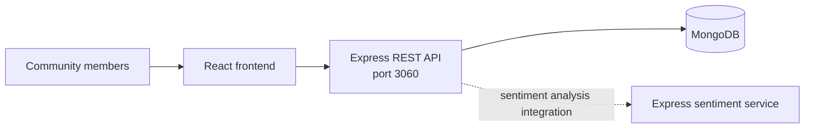

# GiftLink — Community Gift Sharing & Search Platform

IBM Full-Stack JavaScript Developer Professional Certificate capstone.

GiftLink helps community members share household items they no longer need and helps others find available items through a searchable catalog.

[Portfolio case study](https://my-portfolio-rtte.vercel.app/work/giftlink ) · [Repository](https://github.com/A422789/fullstack-capstone-project )

## Features

- Browse and view gift listings.
- Search by category, condition, age, and item name.
- Register and sign in with JWT-based authentication for protected actions.
- Create listings, update user profiles, and comment on items.
- Use a separate sentiment-analysis service for text classification.

## Architecture



## Tech Stack

- **Frontend:** React, React Router, React Bootstrap
- **Backend:** Node.js, Express.js, MongoDB, JWT, bcryptjs
- **Sentiment service:** Express.js and Natural
- **Logging:** Pino

## Repository Structure

```text
.
├── giftlink-backend/    # Express API, routes, MongoDB connection
├── giftlink-frontend/   # React application
├── sentiment/           # Separate sentiment-analysis service
└── .github/workflows/   # GitHub Actions workflow
```

## Run Locally

### Prerequisites

- Node.js and npm
- A running MongoDB instance

### 1. Start the backend

```bash
git clone https://github.com/A422789/fullstack-capstone-project.git
cd fullstack-capstone-project/giftlink-backend
cp .env.sample .env
```

Edit `giftlink-backend/.env` and set:

- `MONGO_URL` to your MongoDB connection string.
- `JWT_SECRET` to a unique local development secret. Do not use the placeholder value from `.env.sample`.

Then install dependencies and start the API:

```bash
npm install
npm run dev
```

The API listens on `http://localhost:3060`.

### 2. Start the frontend

Open a second terminal from the repository root:

```bash
cd fullstack-capstone-project/giftlink-frontend
cp .env.sample .env
```

Set the following in `giftlink-frontend/.env`:

```env
REACT_APP_BACKEND_URL=http://localhost:3060
```

Then install dependencies and start the React development server:

```bash
npm install
npm start
```

### 3. Start the sentiment service when needed

Open another terminal from the repository root if you want to run the separate sentiment service:

```bash
cd fullstack-capstone-project/sentiment
npm install
node index.js
```

The service uses port `3000` by default. If that port is already in use, set `PORT` to another available port before starting it.

## Environment and Secrets

The `.env.sample` files contain placeholders for local configuration. Replace them with your own values, keep real `.env` files out of version control, and never commit production credentials or secrets.

## License

This repository includes an Apache-2.0 license. See [LICENSE](https://github.com/A422789/fullstack-capstone-project/blob/main/LICENSE ).
